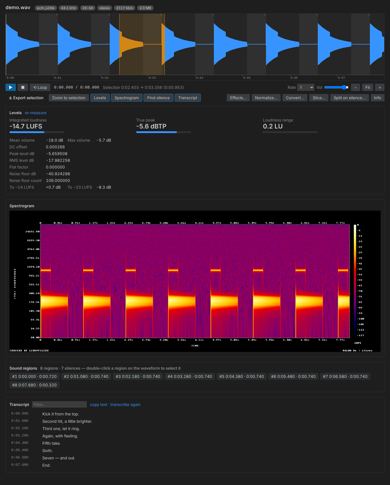
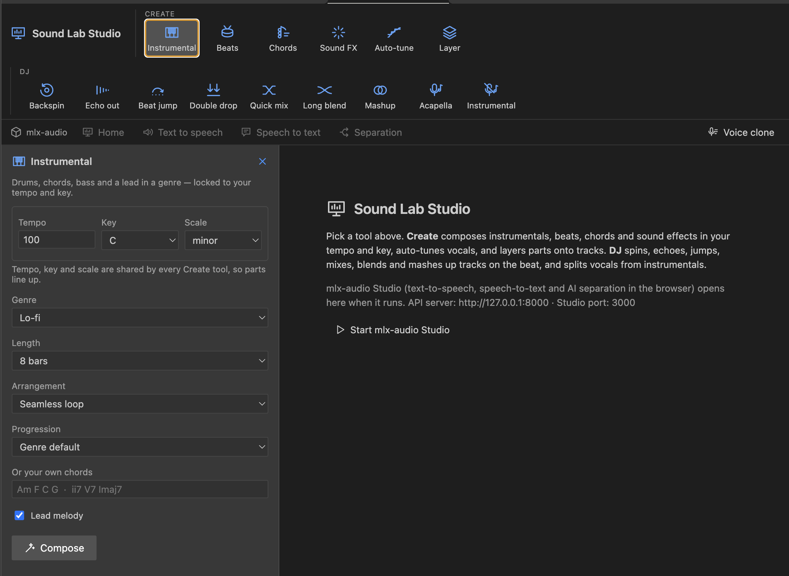

# Sound Lab documentation

Sound Lab is a VS Code extension that turns your own [FFmpeg](https://ffmpeg.org) install into an audio workbench: an interactive waveform editor, sample-accurate cutting and slicing, loudness tools, an effects chain, spectrograms, microphone recording and speech-to-text. Every operation runs locally through `ffmpeg` and `ffprobe`, every result is written to a *new* file, and nothing leaves your machine unless you point transcription at an online API.

*The audio editor, generated by `npm run test:ui` from this repository (a synthetic 8-second signal and placeholder transcript text).*

## At a glance

| | |
|---|---|
| Package | `sound-lab`, display name "Sound Lab — FFmpeg Audio Toolkit", version 0.1.0 |
| Licence | GPL-3.0-only |
| Requires | VS Code 1.85 or newer, plus `ffmpeg` and `ffprobe` (the README names 4.4 as the minimum) |
| Platforms | macOS, Windows and Linux (microphone recording has a backend for each) |
| Runtime dependencies | None. The extension shells out to `ffmpeg`, `ffprobe` and, optionally, `whisper-cli` |
| Source | `github.com/cloud-fronts-group/sound-lab` |
| Snapshot documented here | `main` at commit `b8adc0b` (v0.1.0), checked on 2026-11-03 |

What it does, in one list:

- **Edit**: convert between 7 formats, trim, slice to the beat, split on silence, normalize, join with crossfades, and run a chain of 26 effects.
- **See**: zoomable waveform, loudness report, log-frequency spectrogram, silence regions.
- **Capture**: record from a microphone, generate tones, noise and sweeps.
- **Transcribe**: whisper.cpp, any OpenAI-compatible API, or FFmpeg 8's `whisper` filter, with SRT, VTT, TXT and JSON output and subtitle muxing.
- **Stay safe**: no shell strings, no source overwrites, cancellable jobs, and the ffmpeg command line of every editing or rendering job logged.

## Where to go next

| Page | Read it when you want to… |
|---|---|
| [Getting started](getting-started.md) | install the extension, check FFmpeg, and make your first sample in five minutes |
| [Audio editor](audio-editor.md) | learn the waveform, selections, keyboard shortcuts and the Levels, Spectrogram, Silence and Transcript panels |
| [Samples view and menus](samples-view.md) | find your audio files in the sidebar and know where every command appears |
| [Command reference](commands.md) | look up what a command asks for, what it writes and which ffmpeg command it runs |
| [Effects catalogue](effects.md) | see all 26 effects, their parameters and the exact filter each one builds |
| [Transcription and subtitles](transcription.md) | set up whisper.cpp or an API, and turn speech into SRT, VTT, TXT or JSON |
| [Configuration](configuration.md) | change settings, control the output folder and copy ready-made `settings.json` blocks |
| [Cookbook](cookbook.md) | follow complete workflows: drum kits, podcast clean-up, game audio, subtitles |
| [Architecture](architecture.md) | understand the layers, the command lifecycle, the webview protocol and the limits |
| [FFmpeg internals](ffmpeg-internals.md) | see how each operation maps to ffmpeg arguments, and why |
| [Sound Lab Studio](studio.md) | tour the Studio, mlx-audio and DJ screens shown in the screenshots |
| [Development](development.md) | build, test, package, and add a command, effect or setting |
| [Troubleshooting](troubleshooting.md) | fix "ffmpeg missing", silent previews, transcription errors and surprising output names |
| [Glossary](glossary.md) | decode LUFS, true peak, asegment, ggml and friends |

## Screenshots in these docs

| Image | Shows | Embedded in |
|---|---|---|
| [`images/convert-format-picker.png`](images/convert-format-picker.png) | The "Convert to…" format picker | [Commands](commands.md) |
| [`images/effects-picker.png`](images/effects-picker.png) | The "Pick effects" multi-select over a DJ-styled editor | [Effects](effects.md), [Studio](studio.md) |
| [`images/studio-text-to-speech.png`](images/studio-text-to-speech.png) | The Text to speech panel and its model list | [Studio](studio.md) |
| [`images/sound-lab-studio.png`](images/sound-lab-studio.png) | The Sound Lab Studio screen (Create, DJ and mlx-audio tabs) | [Studio](studio.md) |
| [`images/audio-editor-dark.png`](images/audio-editor-dark.png) | The audio editor, generated by the repo's UI test | [Audio editor](audio-editor.md) |

The first four are screenshots taken on 2026-11-03; [`images/README.md`](images/README.md) records their original file names.

*Sound Lab Studio, as captured in a screenshot. Read [Sound Lab Studio](studio.md) for what is and isn't covered by the source in this repository.*

## Conventions used in these docs

- Commands appear as they do in the Command Palette, for example **Sound Lab: Trim / Cut Sample…**, with the command ID in code font (`soundLab.trim`) where it matters.
- Settings use their full key, for example `soundLab.normalize.targetLufs`.
- ffmpeg command lines are shown in the format the **Sound Lab** output channel uses: `$ ffmpeg …`, with arguments that contain spaces, quotes, `|`, `;` or `&` wrapped in double quotes (a recording's line is logged unquoted).
- Example paths use `~/samples/…`. The extension itself always works with absolute paths.
- Blocks labelled **real output** were produced by compiling this repository and running it against FFmpeg 6.1.1 (an Ubuntu build). Other FFmpeg builds can print slightly different numbers.

## How these docs were checked

- The repository's own suites were run first: 23 of 23 core and activation tests passed against real ffmpeg, and all 29 webview checks passed in Chromium (dark and light themes).
- Argument lists, effect chains, subtitle files and reports in the examples were generated by calling the compiled `core/` code, not typed by hand.
- Every command ID and setting key in `package.json` appears in these pages. Every `soundLab.*` name used here exists in `package.json`, apart from the secret-storage key `soundLab.transcription.apiKey` and a few placeholder names in [Development](development.md) (such as `soundLab.reverse` and `soundLab.your.key`).
- The Studio and DJ-deck screens in the screenshots are **not** implemented in this checkout (`main` contains no Studio, mlx-audio or DJ code), so [Sound Lab Studio](studio.md) describes only what the screenshots show.
