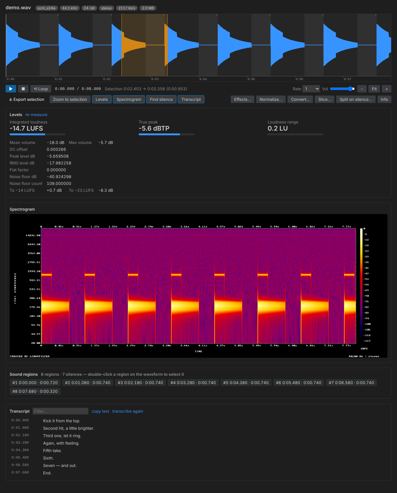

# Audio editor

Opening an audio file in VS Code shows Sound Lab's editor: a zoomable waveform, transport controls, selection export and four analysis panels. It is the fastest way to find a sound and turn it into a new sample.

*Generated by `npm run test:ui` from this repository: a synthetic 8-second signal with eight decaying hits, a selection dragged from 2.40 s to 3.36 s, and placeholder transcript lines.*

> The Studio screenshots in these docs show a DJ-styled variant of the editor (a "Deck B" turntable, a VOL fader, extra buttons). That variant is not in this repository's source. This page documents the editor that is. See [Sound Lab Studio](studio.md).

## Opening a file

| Way | Notes |
|---|---|
| Double-click an audio file in the Explorer | The custom editor has default priority for `wav`, `mp3`, `flac`, `ogg`, `oga`, `opus`, `m4a`, `aac`, `aif`, `aiff`, `wma`, `caf`, `ac3`, `amr`, `webm` and `mka` |
| **Sound Lab: Open in Audio Editor** | With no file selected it uses the audio editor you used last (if still open), otherwise it shows a file picker |
| Click a file in the [Samples view](samples-view.md) | Uses `vscode.openWith` with the Sound Lab editor |
| *Reopen Editor With…* | Use VS Code's own command to switch a file back to another editor |

Several editors can show the same file; they stay in sync (a new transcript appears in all of them). The editor keeps its state when you switch tabs.

## Layout

From top to bottom:

1. **Header**: the file name and a row of chips (codec, sample rate, bit depth, channels, bitrate, file size, and the `title` tag in quotes if there is one). The bit-depth chip adds "float" for float sample formats.
2. **Waveform**: 220 px tall. It shows min/max peaks per pixel, silence regions as grey bands, the selection in orange, a tick at the top for each transcript cue, a time ruler along the bottom, a faint hover line and the playhead.
3. **Transport bar**: play/pause, stop, **Loop**, the position and duration, the selection range, a **Rate** menu (0.5, 0.75, 1, 1.25, 1.5 or 2), a **Vol** slider (starts at 0.9) and zoom buttons (−, **Fit**, +).
4. **Action bar**: **Export selection**, **Zoom to selection**, the four panel toggles (**Levels**, **Spectrogram**, **Find silence**, **Transcript**), and buttons that run commands on this file: **Effects…**, **Normalize…**, **Convert…**, **Slice…**, **Split on silence…**, **Info**.
5. **Panels**, in that order, each opened and closed by its toggle.

The editor also adds three buttons to the editor title bar while it is focused: **Transcribe**, **Effects** and **Info** (media info).

## Mouse

| Gesture | Effect |
|---|---|
| Drag on the waveform | Make a selection (a movement under 3 px counts as a click) |
| Click | Move the playhead there |
| Shift + click | When a selection exists, move its nearest edge to the click |
| Double-click | Select the sound region under the cursor (after **Find silence** has run); with no region there, clear the selection |
| Mouse wheel | Zoom, anchored under the cursor |
| Shift + wheel, or a horizontal wheel | Pan |
| Alt + drag, or middle-button drag | Pan |

A selection must be longer than 0.5 ms to count. Dragging outside the canvas clamps to the start or end of the file.

## Keyboard

| Key | Effect |
|---|---|
| `Space` | Play or pause. With a selection, playback starts at its start if the playhead is outside it |
| `Home` | Stop; return to the selection start (or 0:00) |
| `L` | Toggle loop |
| `E` | Export the selection |
| `Z` | Zoom to the selection, with 5% padding on each side |
| `0` | Fit the whole file |
| `+` or `=` | Zoom in |
| `-` | Zoom out |
| `←` / `→` | Seek 1 s back or forward; hold Shift for 5 s |
| `Esc` | Clear the selection |

Shortcuts are ignored while a text field or menu has focus, such as the transcript filter.

## Selections and export

Drag to select, then press `E` or click **Export selection**. Sound Lab asks for fade-in and fade-out times (default `0.005, 0.010`, in seconds), then runs the **Trim / Cut Sample…** engine:

- The cut is sample-accurate: `-ss` and `-t` are placed before `-i` and the audio is re-encoded.
- The result keeps the source's format and bit depth, and is named `<source>_<m.ss>-<m.ss>.<ext>`; see [file naming](commands.md#output-file-naming).
- A toast confirms `Saved <name>`, and the new file appears in the Samples view.

Playback respects the selection: it stops at the selection's end, or wraps to its start when **Loop** is on. When the playhead leaves the visible area during playback, the view scrolls to keep it in sight.

## Panels

### Levels

Measures the whole file with two ffmpeg passes (`astats` plus `volumedetect`, then `loudnorm` in analysis mode) and shows:

- **Integrated loudness**, **True peak** and **Loudness range**, each with a small meter.
- **Mean volume** and **Max volume**.
- Selected `astats` rows: peak level, RMS level, DC offset, flat factor and noise floor (as in the screenshot above). The panel also looks for crest factor, dynamic range and zero-crossings rate, but FFmpeg 6.1.1's overall `astats` block does not print them.
- **To −14 LUFS** and **To −23 LUFS**: the gain you would need to reach those targets, such as `+0.7 dB`.

The panel measures once. Click **re-measure** after the file changes on disk. For a Markdown report that includes more targets (Apple Music, podcasts, ATSC A/85), run **Sound Lab: Analyze Loudness & Levels**.

### Spectrogram

A log-frequency, log-intensity spectrogram rendered by ffmpeg's `showspectrumpic` at the width of the editor (times the screen's pixel ratio, clamped to 400–4096 px) and 512 px high. Click the image to move the playhead there. Images are cached by file, modification time and width, so reopening the panel is instant.

The picture carries a legend, so the plot is not the whole image. The editor assumes the plot starts 141 px from the left and the image is 282 px wider than the plot, which is exact for 44.1 kHz audio; the legend margin grows slightly with the sample rate (284 px in total at 48 kHz), so clicks on 48 kHz material can be a pixel or two off. On the FFmpeg build used for these docs (6.1.1) a requested 800×512 image of 44.1 kHz audio came out as 1082×640.

### Find silence

Runs `silencedetect` with `soundLab.silence.thresholdDb` (−40 dB) and `soundLab.silence.minDuration` (0.35 s), then turns the silences into **sound regions** by inverting them, adding `soundLab.silence.padding` (0.03 s) on each side and dropping regions shorter than `soundLab.silence.minSegment` (0.08 s).

- Silences are shaded on the waveform.
- Regions appear as chips such as `#2 0:01.080 · 0:00.740` (start, then length).
- **Click** a chip to select the region and play it. **Shift-click** selects without playing.
- **Double-click** a region on the waveform to select it.

To export every region at once, use **Split on Silence…** (the **Split on silence…** button).

### Transcript

Shows timed lines from a transcript that already exists next to the audio (or in your output folder): `<name>.json` first, then `.srt`, then `.vtt`. Without one, the panel offers **Transcribe now**.

- Type in **Filter…** to narrow the lines.
- **Click** a line to play from there. **Shift-click** selects the line's time range, ready for **Export selection**.
- **copy text** copies all lines. **transcribe again** reruns the command (see [Transcription](transcription.md)).
- While audio plays, the current line is highlighted and scrolled into view inside the list.

## Staying current

When the file changes on disk (for example after you overwrite it), the editor reloads the waveform and info chips. The Levels panel has **re-measure**; to refresh a spectrogram, reopen the editor. A new transcript from **Transcribe** updates every open editor on that file.

## Theming

The editor uses only VS Code theme variables, so it follows whichever theme is active. The waveform colour is `--vscode-charts-blue`, the selection colour is `--vscode-charts-orange`, and the playhead is the editor cursor colour. The UI test renders and checks both a dark and a light theme.

## Examples

**Cut a phrase out of dialogue.** Run **Transcribe**, open the **Transcript** panel, type a word into **Filter…**, Shift-click the line, press `E`, press Enter at the fade prompt. You get `interview_0.12-0.18.wav` (the suffix is minutes.seconds of the cut).

**Audition drum hits.** Click **Find silence**, click each `#n` chip to hear it, Shift-click the ones you want and press `E`. To keep all of them in one go, use **Split on silence…** and see the [cookbook](cookbook.md#chop-a-drum-session-into-one-shots).

**Practise a passage.** Select a bar, press `L` to loop, set **Rate** to 0.5, press `Space`.

**Check loudness before delivery.** Open **Levels**. If the **To −14 LUFS** row reads `+0.7 dB`, the file is 0.7 dB quieter than a −14 LUFS streaming target. Use **Normalize…** to fix it.

## Limits

| Topic | Behaviour |
|---|---|
| Very long files | The waveform is capped at 60,000 buckets, decoded at 8 kHz (over 60 s) or 4 kHz (over 10 minutes), so fine detail at high zoom is coarser on long files |
| Formats the browser cannot play | Played from a cached FLAC transcode (first open takes a moment) |
| No audio stream | The editor shows "No audio stream in this file." |
| Playback fails | The editor shows a message; analysis tools keep working |

Details and formulas are in [Architecture](architecture.md#14-limits-built-into-the-code).
