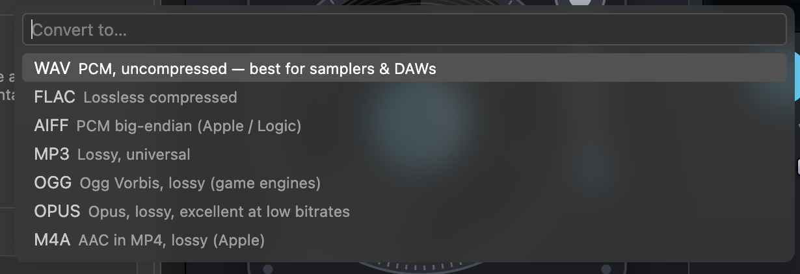

# Command reference

Sound Lab contributes 23 commands, all in the **Sound Lab** category of the Command Palette. This page says, for each one, what it asks, what it writes and which ffmpeg command it runs. Where a command line is shown it is the one Sound Lab runs (**real output** from the compiled code, with example file names). For most commands the extension also writes it to the **Sound Lab** output channel as `$ ffmpeg …`.

For where each command appears in menus, see [Samples view and menus](samples-view.md#where-each-command-appears).

## Quick reference

| Command | ID | Result |
|---|---|---|
| Open in Audio Editor | `soundLab.openPreview` | Opens the file in the [audio editor](audio-editor.md) |
| Show Media Info (ffprobe) | `soundLab.probe` | Markdown report beside the editor |
| Analyze Loudness & Levels | `soundLab.analyze` | Markdown report beside the editor |
| Convert Format… | `soundLab.convert` | One new file per input |
| Batch Convert Folder… | `soundLab.batchConvert` | A `converted_<fmt>/` tree |
| Trim / Cut Sample… | `soundLab.trim` | One new file |
| Normalize Loudness… | `soundLab.normalize` | One new file per input |
| Extract Audio from Video… | `soundLab.extractAudio` | One new file per input |
| Slice into Equal Chunks… | `soundLab.sliceEqual` | A `<name>_slices/` folder |
| Split on Silence… | `soundLab.splitOnSilence` | A `<name>_split/` folder per input |
| Apply Effects / Filter Chain… | `soundLab.applyEffects` | One new file per input |
| Render Waveform Image | `soundLab.waveformImage` | A PNG |
| Render Spectrogram Image | `soundLab.spectrogramImage` | A PNG |
| Transcribe Audio… | `soundLab.transcribe` | `.srt`, `.vtt`, `.txt`, `.json` |
| Set Transcription API Key | `soundLab.setApiKey` | Stores or removes a secret |
| Record Sample from Microphone… | `soundLab.record` | One new file |
| Generate Tone / Noise… | `soundLab.generateTone` | One new file |
| Concatenate Files… | `soundLab.concat` | One new file |
| Add Subtitles to Video… | `soundLab.muxSubtitles` | One new video file |
| FFmpeg Recipes (open in terminal)… | `soundLab.recipes` | Types a command into a terminal |
| Show FFmpeg Capabilities | `soundLab.showCapabilities` | Markdown report |
| Show FFmpeg Log | `soundLab.showLog` | Opens the output channel |
| Refresh Samples | `soundLab.refreshSamples` | Refreshes the Samples view (hidden from the palette) |

## Output file naming

Results go next to the source file, or into `soundLab.output.directory` if set ([Configuration](configuration.md#output-location)). The pattern depends on the command:

| Command | Pattern | Example |
|---|---|---|
| Convert (new format) | `<name>.<ext>` | `kick.wav` → `kick.flac` |
| Convert (same format) | `<name>_converted.<ext>` | `kick_converted.wav` |
| Batch Convert | `<folder>/converted_<fmt>/<relative path>.<fmt>` | `converted_ogg/drums/kick.ogg` |
| Trim, Export selection | `<name>_<start>-<end>.<ext>` | `take1_0.12-0.18.wav` |
| Normalize, loudness | `<name>_<target>LUFS.<ext>` | `vocals_-14LUFS.wav` |
| Normalize, peak | `<name>_peak<level>.<ext>` | `kick_peak-0.1.wav` |
| Slice | `<name>_slices/<name>_001.<ext>`, `_002`… | `loop_slices/loop_001.wav` |
| Split on Silence | `<name>_split/<name>_001.<ext>`, `_002`… | `session_split/session_001.wav` |
| Apply Effects, one effect | `<name>_<effect id>.<ext>` | `vocals_highpass.wav` |
| Apply Effects, several | `<name>_fx.<ext>` | `vocals_fx.wav` |
| Concatenate | `<first file>_concat.<ext>` | `a_concat.wav` |
| Extract Audio | `<name>_audio.<ext>` | `clip_audio.m4a` |
| Waveform, spectrogram | `<name>_waveform.png`, `<name>_spectrogram.png` | `take1_waveform.png` |
| Transcribe | `<name>.srt`, `.vtt`, `.txt`, `.json` | `interview.srt` |
| Add Subtitles | `<name>_subtitled.<ext>` | `talk_subtitled.mp4` |
| Record | `recording-YYYYMMDD-HHMMSS.<fmt>` | `recording-20261103-120000.wav` |
| Generate | `<kind>[_<freq>Hz]_<seconds>s.<fmt>` | `sine_440Hz_2s.wav` |

Rules that apply everywhere:

- **Collisions get a number.** If the name is taken, Sound Lab tries `name-1.ext`, `name-2.ext`… (for folders: `name_slices-1`). Turn on `soundLab.output.overwrite` to reuse the name instead.
- **Trim stamps are `m.ss`, floored.** `formatTimecode(sec, false)` (seconds floored, no milliseconds) with `:` replaced by `.` gives `0.12` for 12.5 s, `1.15` for 75.3 s and `1.02.05` for 3,725 s. A selection from 0.5 s to 1.75 s becomes `0.00-0.01`. Two sub-second cuts of the same file therefore differ only by the `-1`, `-2` suffix.
- **Exceptions to "never overwrite".** Transcripts and `converted_<fmt>/` outputs are rewritten when you run the command again. See [Architecture](architecture.md#13-security-and-privacy).

## Shared behaviour

**Choosing files.** A command uses the file(s) you right-clicked, the active audio editor, or asks you to pick one. Commands that accept several files take a multi-selection from the Explorer.

**Progress and cancelling.** Long work runs in a progress notification with **Cancel**. Cancelling kills the running ffmpeg process; an output file ffmpeg had started may remain on disk. **Convert** and **Batch Convert** show `name (i/n)` while they work; the other multi-file commands show the file name and the current step.

**Result notification.** After most commands, a message says `Created <name>` (or `Converted`, `Sliced into`, …) with **Open** and **Reveal** buttons; for several files only **Reveal**.

**Encoding rules.** How the output is encoded depends on the kind of command:

| Operation | Format | Bit depth | Sample rate | Lossy bitrate |
|---|---|---|---|---|
| Convert, Batch Convert | Your choice in the prompt | Your choice (lossless formats) | Your choice, or keep | Your choice |
| Extract Audio, "Encode to…" | Your choice | `soundLab.defaults.bitDepth` | `soundLab.defaults.sampleRate` | `soundLab.defaults.mp3Bitrate` |
| Trim, Normalize, Effects, Slice, Split, Concatenate | The **source's own format** if it is WAV, FLAC, AIFF, MP3, Ogg, Opus or M4A; otherwise `soundLab.defaults.format` | For WAV, AIFF and FLAC sources, the source's (16, 24 or 32; FLAC is capped at 24); otherwise `soundLab.defaults.bitDepth`. Concatenate never reads the source's depth and always uses `soundLab.defaults.bitDepth` | `soundLab.defaults.sampleRate` if it is not 0, otherwise the source's rate (see the notes on Normalize and Concatenate) | `soundLab.defaults.mp3Bitrate` |
| Record, Generate | `soundLab.defaults.format` | `soundLab.defaults.bitDepth` | `soundLab.defaults.sampleRate` (Generate uses 48 kHz when it is 0; Record leaves the device's rate alone) | `soundLab.defaults.mp3Bitrate` |

Two consequences worth knowing. First, a non-zero `soundLab.defaults.sampleRate` resamples *every* edit, not only new material. Second, editing a lossy file re-encodes it: an MP3 you trim stays an MP3 at `soundLab.defaults.mp3Bitrate` (320k by default), which costs a generation of quality. For repeated edits, convert to WAV first.

---

## Inspect

### Open in Audio Editor

`soundLab.openPreview`. Opens the selected file in the Sound Lab [audio editor](audio-editor.md). With no file selected it uses the audio editor you used most recently (if it is still open), otherwise a file picker appears. Non-audio files open in VS Code's default editor.

### Show Media Info (ffprobe)

`soundLab.probe`. Runs `ffprobe -v error -print_format json -show_format -show_streams -show_chapters <file>` and opens a Markdown report beside the editor with the container, duration, size, overall bitrate, one table per stream (codec, rate, channels, sample format, bit depth, bitrate, video resolution, stream tags), the metadata tags, chapters, and the raw JSON in a collapsible block. **Real output** for a tagged FLAC (raw JSON omitted):

```markdown
# kick_01.flac

| Property | Value |
|---|---|
| Container | raw FLAC |
| Duration | 1.000 s |
| Size | 33 KB |
| Overall bitrate | 269 kb/s |

## Stream #0 — audio

| Property | Value |
|---|---|
| Codec | FLAC (Free Lossless Audio Codec) |
| Sample rate | 48000 Hz |
| Channels | 1 (mono) |
| Sample format | s32 |
| Bit depth | 24 |

## Metadata

| Tag | Value |
|---|---|
| title | Kick 01 |
| artist | Studio B |
| bpm | 128 |
| encoder | Lavf60.16.100 |
```

### Analyze Loudness & Levels

`soundLab.analyze`. Measures the file in two passes and opens a Markdown preview beside the editor:

1. `ffmpeg … -af astats=measure_perchannel=none,volumedetect -f null -` for peak, RMS, DC offset, noise floor and more.
2. `ffmpeg … -af loudnorm=I=-23:TP=-1:LRA=11:print_format=json -f null -` for integrated loudness, true peak and loudness range.

The report ends with a table of streaming targets and the gain needed to reach each. **Real output** for 6 seconds of pink noise generated with a −30 dBFS level setting (its measured peak is a couple of dB lower, as the report shows):

```markdown
# Levels — pink_30dB.wav

| Measure | Value |
|---|---|
| Integrated loudness | -44.7 LUFS |
| True peak | -31.4 dBTP |
| Loudness range | 0.0 LU |
| Mean volume | -44.1 dB |
| Max volume | -31.8 dB |
| Peak level dB | -31.812514 |
| RMS level dB | -44.128410 |
| RMS peak dB | -40.567513 |
| RMS trough dB | -46.976763 |
| DC offset | 0.000067 |
| Noise floor dB | -36.818880 |
| Bit depth | 18/24/24/24 |
| Number of samples | 288000 |

### Streaming targets

| Platform | Target | Gain needed |
|---|---|---|
| Spotify / YouTube / Tidal | -14 LUFS | +30.7 dB |
| Apple Music | -16 LUFS | +28.7 dB |
| Podcasts (Apple) | -16 LUFS | +28.7 dB |
| EBU R128 broadcast | -23 LUFS | +21.7 dB |
| ATSC A/85 (US TV) | -24 LUFS | +20.7 dB |
```

The "Bit depth" row is passed through unchanged from FFmpeg's `astats` filter. The report lists only the `astats` rows FFmpeg printed: the code also looks for *Crest factor*, *Dynamic range* and *Zero crossings rate*, but FFmpeg 6.1.1 does not print those in the overall block, so they are absent here.

### Show FFmpeg Capabilities

`soundLab.showCapabilities`. Re-detects your FFmpeg and opens a report with both versions and two tables: the **12 filters** Sound Lab uses (`loudnorm`, `silencedetect`, `astats`, `volumedetect`, `showspectrumpic`, `showwavespic`, `afftdn`, `acompressor`, `alimiter`, `acrusher`, `rubberband`, `whisper`) and the **6 encoders** (`pcm_s24le`, `flac`, `libmp3lame`, `libvorbis`, `libopus`, `aac`), each marked ✅ or ❌, followed by your build's total filter and encoder counts. `rubberband` and `whisper` are optional. Clicking the status bar item runs this command.

### Show FFmpeg Log

`soundLab.showLog`. Reveals the **Sound Lab** output channel. It records each job's title; the command line of every job that creates or renders a file (convert, trim, normalize, slice, split, effects, concatenate, extract, record, images, subtitles, generate); ffmpeg's own messages; and errors. **Analyze Loudness & Levels** and **Show Media Info** log only their titles, and **Transcribe** logs its backend's messages but no `$` command line. See [Getting started](getting-started.md#5-watch-what-ffmpeg-is-doing).

---

## Convert and edit

### Convert Format…

`soundLab.convert`. Converts one or more files. You are asked, in order:



*Step 1 of **Convert Format…**, as captured in a screenshot: seven formats, each with a hint.*

1. **Format**: WAV, FLAC, AIFF, MP3, OGG, OPUS or M4A.
2. **Bit depth** (WAV, FLAC, AIFF): 24-bit, 16-bit, or `32-bit float` (WAV and AIFF) / `24-bit (FLAC max)` (FLAC). **Bitrate** (MP3, OGG, OPUS, M4A): 320k, 256k, 192k, 160k, 128k, 96k or 64k.
3. **Sample rate**: keep the source's, or 44100, 48000, 88200, 96000, 32000, 22050 or 16000.
4. **Channels**: keep, mono or stereo.

Only the **first audio stream** is converted, and the file's tags are copied (`-map 0:a:0 -map_metadata 0`). Examples (**real output**):

```bash
# WAV → 24-bit FLAC
$ ffmpeg -hide_banner -nostdin -y -i kick.wav -map 0:a:0 -map_metadata 0 -c:a flac -compression_level 8 -sample_fmt s32 -bits_per_raw_sample 24 kick.flac
# → 320k MP3
$ ffmpeg -hide_banner -nostdin -y -i kick.wav -map 0:a:0 -map_metadata 0 -c:a libmp3lame -b:a 320k kick.mp3
# → Opus at 44.1 kHz requested: the rate is coerced to 48 kHz, and 320k becomes 160k
$ ffmpeg -hide_banner -nostdin -y -i mix.wav -map 0:a:0 -map_metadata 0 -c:a libopus -b:a 160k -ar 48000 mix.opus
# → 16-bit mono 22.05 kHz WAV from a file with a space in its name
$ ffmpeg -hide_banner -nostdin -y -i "take 1.wav" -map 0:a:0 -map_metadata 0 -c:a pcm_s16le -ar 22050 -ac 1 "take 1_converted.wav"
```

Codec details to keep in mind:

| Format | Codec | Notes |
|---|---|---|
| WAV | `pcm_s16le`, `pcm_s24le`, `pcm_f32le` | 32-bit is **float** |
| AIFF | `pcm_s16be`, `pcm_s24be`, `pcm_s32be` | The "32-bit float" menu entry actually writes 32-bit **integer** PCM for AIFF |
| FLAC | `flac -compression_level 8` | 24-bit uses `-sample_fmt s32 -bits_per_raw_sample 24`; 16-bit uses `s16` |
| MP3 | `libmp3lame -b:a <rate>` | |
| Ogg | `libvorbis -q:a 7` | Variable bitrate; the bitrate you pick is ignored |
| Opus | `libopus -b:a <rate>` | The rate you pick is used up to 256k, otherwise 160k. Sample rates other than 8, 12, 16, 24 and 48 kHz become 48 kHz |
| M4A | `aac -b:a <rate>` | The rate you pick is used up to 320k, otherwise 256k |

Full codec matrix: [FFmpeg internals](ffmpeg-internals.md#3-codec-and-format-matrix).

### Batch Convert Folder…

`soundLab.batchConvert`. Converts every audio file in a folder tree, keeping the folder structure.

1. Pick a folder (right-click a folder in the Explorer, or choose one in a dialog).
2. Sound Lab scans it (down to 12 levels of subfolders, skipping any file or folder whose name starts with `.`, and `node_modules`) for audio files. If there are none, you get a warning.
3. You answer the same format, bit depth or bitrate, sample rate and channels prompts as in **Convert Format…**.
4. A modal confirmation asks `Convert N files to FLAC into converted_flac/ ?`.
5. Files convert one by one. A file that fails is logged as `skipped <path>: <reason>` and counted; at the end a warning says how many failed.

Output goes to `<folder>/converted_<fmt>/<relative path>.<fmt>`, so `drums/kick.wav` becomes `converted_ogg/drums/kick.ogg`. Files already inside the destination are skipped. Running it again into the same folder **overwrites** the earlier results. Only audio extensions are scanned (not video containers such as `.mp4`).

### Trim / Cut Sample…

`soundLab.trim`. Cuts a time range into a new file. You are asked for:

1. **Start time** (default `0:00.000`) and **End time** (default: the end of the file). Times may be seconds (`12.25`, `90s`), `m:ss.ms` (`1:02.5`) or `h:mm:ss` (`01:00:01`). Invalid input, or an end before the start, is rejected.
2. **Fade in, fade out** in seconds (default `0.005, 0.010`), to avoid clicks.

From the audio editor, **Export selection** supplies the range and asks only for the fades. The cut is sample-accurate: `-ss` and `-t` come before `-i`, and the audio is re-encoded in the source's format. **Real output** for 12.5 s to 18.25 s with the default fades:

```bash
$ ffmpeg -hide_banner -nostdin -y -ss 12.500000 -t 5.750000 -i take1.wav -map 0:a:0 -af afade=t=in:st=0:d=0.005,afade=t=out:st=5.740000:d=0.01 -c:a pcm_s24le take1_0.12-0.18.wav
```

Without fades the `-af` argument is omitted. The result is named `<name>_<start>-<end>.<ext>`; see [Output file naming](#output-file-naming).

### Normalize Loudness…

`soundLab.normalize`. Makes the file a target loudness, or a target sample peak. You choose one of six targets:

| Choice | Meaning |
|---|---|
| `Loudness <your setting> LUFS` | EBU R128 two-pass, using `soundLab.normalize.targetLufs` (default −14) |
| `Loudness -14 LUFS` | Spotify, YouTube, Tidal |
| `Loudness -16 LUFS` | Apple Music, podcasts |
| `Loudness -23 LUFS` | EBU R128 broadcast |
| `Peak -0.1 dBFS` | Sample-peak normalization for samples and one-shots |
| `Peak -1.0 dBFS` | Sample-peak normalization with headroom |

(If your setting equals −14, −16 or −23 you will see that entry twice.)

**Loudness modes** run two passes and use `soundLab.normalize.truePeak` (−1 dBTP) and `soundLab.normalize.lra` (11 LU):

```bash
# Pass 1: measure
$ ffmpeg -hide_banner -nostdin -i vocals.wav -map 0:a:0 -af loudnorm=I=-14:TP=-1:LRA=11:print_format=json -f null -
# Pass 2: apply, with the measured values and linear=true (example numbers)
$ ffmpeg -hide_banner -nostdin -y -i vocals.wav -map 0:a:0 -af loudnorm=I=-14:TP=-1:LRA=11:measured_I=-24.13:measured_TP=-9.80:measured_LRA=6.40:measured_thresh=-34.60:offset=0.12:linear=true:print_format=summary -c:a pcm_s24le -ar 44100 vocals_-14LUFS.wav
```

`loudnorm` upsamples internally to 192 kHz, so Sound Lab always puts the sample rate back with `-ar` (your `soundLab.defaults.sampleRate`, or the source's). The log shows `measured: I=… LUFS, TP=… dBTP, LRA=… LU` between the passes. FFmpeg's documentation notes that linear mode reverts to dynamic normalization when a pure gain change cannot reach the target without breaching the true-peak or loudness-range limits, so check hard cases with **Analyze Loudness & Levels**.

**Real run:** 6 s of pink noise generated with a −30 dBFS level setting, target −14 LUFS / −1 dBTP / 11 LU. Pass 1 measured −44.67 LUFS and a −31.42 dBTP peak; the output measured **−14.07 LUFS** and **−1.06 dBTP**, at 48 kHz and 24-bit.

**Peak modes** measure with `volumedetect`, then apply one gain. A −6.0 dB peak normalized to −0.1 dBFS gets `volume=5.90dB` (**real run**: the output peaked at −0.1 dB):

```bash
$ ffmpeg -hide_banner -nostdin -i kick.wav -map 0:a:0 -af volumedetect -f null -
$ ffmpeg -hide_banner -nostdin -y -i kick.wav -map 0:a:0 -af volume=5.90dB -c:a pcm_s24le kick_peak-0.1.wav
```

Results keep the source format and bit depth and are named `<name>_<target>LUFS.<ext>` or `<name>_peak<level>.<ext>`.

### Slice into Equal Chunks…

`soundLab.sliceEqual`. Cuts one file into many, sample-accurately, in a single ffmpeg pass. Choose how to slice:

| Mode | You enter | Slice length |
|---|---|---|
| By tempo | BPM (default 120) and beats per slice (default 1; `0.5` = eighths, `4` = one 4/4 bar) | `60 / BPM × beats` seconds |
| By seconds | A length (default 1) | That length |
| Into N equal parts | N (default 16, a whole number ≥ 1) | `duration / N` |

The slice length in samples can be fractional. For example, at 128 BPM an eighth note is 10,335.9375 samples at 44.1 kHz:

| BPM | Beats per slice | Sample rate | Seconds per slice | Samples per slice |
|---|---|---|---|---|
| 120 | 1 | 44100 | 0.50000 | 22050 |
| 120 | 0.5 | 48000 | 0.25000 | 12000 |
| 128 | 0.5 | 44100 | 0.23438 | 10335.9375 |
| 128 | 4 | 48000 | 1.87500 | 90000 |
| 90 | 1 | 44100 | 0.66667 | 29400 |

Sound Lab rounds **each cut position independently** (`round(i × samplesPerSlice)`), so rounding error never accumulates. **Real output** for 3 s at 44.1 kHz (132,300 samples) in 128 BPM eighths: 12 cuts at 10336, 20672, 31008, 41344, 51680, 62016 … 124031, giving 12 slices of 10,336 samples (one of them 10,335) plus a final remainder of 8,269: 13 files and 132,300 samples in all. The last slice is whatever is left over.

The command line for four slices (cuts at 1 s, 2 s and 3 s of a 44.1 kHz file):

```bash
$ ffmpeg -hide_banner -nostdin -y -i loop.wav -filter_complex "[0:a:0]asegment=samples=44100|88200|132300[s0][s1][s2][s3]" -map [s0] -c:a pcm_s24le loop_slices/loop_001.wav -map [s1] -c:a pcm_s24le loop_slices/loop_002.wav -map [s2] -c:a pcm_s24le loop_slices/loop_003.wav -map [s3] -c:a pcm_s24le loop_slices/loop_004.wav
```

Files go into `<name>_slices/` as `<name>_001.<ext>`, `_002`… in the source's format. A run that would produce more than 2,000 slices is refused with a warning. Why `asegment` and not ffmpeg's `segment` muxer: [FFmpeg internals](ffmpeg-internals.md#5-sample-accurate-slicing).

### Split on Silence…

`soundLab.splitOnSilence`. Finds the sound between silences and saves each piece as its own file; good for drum hits, vocal phrases and one-shots. You are asked for:

1. **Silence threshold** in dBFS (must be 0 or below; raise it, for example to −30, for noisy recordings).
2. **Minimum silence length** that separates samples, in seconds.

> **Your answers are saved.** Both values are written to your *user* settings as `soundLab.silence.thresholdDb` and `soundLab.silence.minDuration`, so they become the defaults for next time and for the editor's **Find silence** panel.

Then Sound Lab runs `silencedetect`, inverts the silences into sound segments, applies `soundLab.silence.padding` (default 0.03 s) around each, drops segments shorter than `soundLab.silence.minSegment` (default 0.08 s), and trims each one with a 2 ms fade-in and a 5 ms fade-out into `<name>_split/<name>_001.<ext>`, `_002`… If nothing is found, the log says `no sound segments found in <file>`.

**Real run** on `gappy.wav`: 0.5 s tone, 1.0 s gap, 0.7 s tone, 0.6 s gap, 0.4 s tone, with the default −40 dB and 0.35 s:

```text
silence_start: 0.5
silence_end: 1.50002 | silence_duration: 1.00002
silence_start: 2.2
silence_end: 2.80002 | silence_duration: 0.600021
segments (after 0.03 s padding): 0–0.53, 1.47–2.23, 2.77–3.2
$ ffmpeg -hide_banner -nostdin -y -ss 1.470020 -t 0.759980 -i gappy.wav -map 0:a:0 -af afade=t=in:st=0:d=0.002,afade=t=out:st=0.754980:d=0.005 -c:a pcm_s24le gappy_split/gappy_002.wav
```

A full drum-session walk-through is in the [cookbook](cookbook.md#chop-a-drum-session-into-one-shots).

### Apply Effects / Filter Chain…

`soundLab.applyEffects`. Pick one or more of 26 effects, enter each effect's parameters, and Sound Lab joins them into one `-af` chain applied to each selected file. The chain follows the **list order**, not the order in which you tick items. A single effect names the output `<name>_<effect id>.<ext>`; several produce `<name>_fx.<ext>`. The effects, their parameters and the exact filters are in the [Effects catalogue](effects.md).

### Concatenate Files…

`soundLab.concat`. Joins files into one.

1. Choose the files (select several in the Explorer, or select one and a dialog lets you add more).
2. Choose the order: **As listed**, or **Sorted by file name** (natural sort, so `take2` comes before `take10`).
3. Enter a **crossfade** in seconds (0 means a straight join).

The output is `<first file>_concat.<ext>`, in the first file's format and at `soundLab.defaults.bitDepth` (24 by default). Every input is first resampled and converted to a common layout so ffmpeg's `concat` and `acrossfade` accept it, and that layout is **48 kHz stereo** (the rate is `soundLab.defaults.sampleRate` if you set it). So mono sources come out as stereo, and 44.1 kHz material comes out at 48 kHz unless you set the default rate. **Real run:** two mono 44.1 kHz files → one 48 kHz stereo file of 2.000 s; with `soundLab.defaults.sampleRate` set to 44100, 44.1 kHz stereo; with a 0.25 s crossfade the total is 1.750 s (each crossfade removes its length once).

```bash
# no crossfade
$ ffmpeg -hide_banner -nostdin -y -i a.wav -i b.wav -i c.wav -filter_complex "[0:a:0]aresample=48000,aformat=sample_fmts=fltp:channel_layouts=stereo[a0];[1:a:0]aresample=48000,aformat=sample_fmts=fltp:channel_layouts=stereo[a1];[2:a:0]aresample=48000,aformat=sample_fmts=fltp:channel_layouts=stereo[a2];[a0][a1][a2]concat=n=3:v=0:a=1[out]" -map [out] -c:a pcm_s24le -ar 48000 a_concat.wav
# 0.25 s crossfade: the concat step becomes a chain of acrossfade filters
…;[a0][a1]acrossfade=d=0.25[x1];[x1][a2]acrossfade=d=0.25[out]
```

### Extract Audio from Video…

`soundLab.extractAudio`. Pulls the audio out of one or more video (or audio) files. Choose:

- **Copy original audio stream**: no re-encode, instant and lossless. The extension follows the codec: AAC and ALAC → `.m4a`, MP3 → `.mp3`, Opus → `.opus`, Vorbis → `.ogg`, FLAC → `.flac`, AC-3 → `.ac3`, E-AC-3 → `.eac3`, any PCM → `.wav`, anything else → `.mka`.
- **Encode to <FORMAT>**: re-encodes with your `soundLab.defaults.*` settings (no further prompts).

Only the first audio stream is extracted (`-vn -sn -dn -map 0:a:0`). A file without audio is skipped and logged. Output: `<name>_audio.<ext>`.

```bash
$ ffmpeg -hide_banner -nostdin -y -i clip.mp4 -vn -sn -dn -map 0:a:0 -c:a copy clip_audio.m4a
```

---

## Render images

### Render Waveform Image and Render Spectrogram Image

`soundLab.waveformImage`, `soundLab.spectrogramImage`. Write a PNG next to the source and open it beside the editor.

```bash
$ ffmpeg -hide_banner -nostdin -y -i take1.wav -filter_complex [0:a:0]aformat=channel_layouts=mono,showwavespic=s=1800x360:colors=#4fc3f7:scale=sqrt -frames:v 1 take1_waveform.png
$ ffmpeg -hide_banner -nostdin -y -i take1.wav -filter_complex [0:a:0]showspectrumpic=s=1600x600:mode=combined:color=intensity:scale=log:fscale=log:legend=1 -frames:v 1 take1_spectrogram.png
```

The waveform is a mono mix at 1800×360. The spectrogram is requested at 1600×600; because of the legend, FFmpeg 6.1.1 produced a **1882×728** image for a 44.1 kHz file. The legend always adds 128 px of height and a width margin that grows with the sample rate (**real run**, requested 800×300: 1066×428 at 22.05 kHz, 1082×428 at 44.1 kHz, 1084×428 at 48 kHz, 1098×428 at 96 kHz).

---

## Speech

### Transcribe Audio…

`soundLab.transcribe`. Turns speech into timed text with the backend chosen by `soundLab.transcription.backend` and writes the files listed in `soundLab.transcription.outputFormats` (default `srt`, `vtt`, `txt`, `json`) next to the audio. The first time, it can help you pick a whisper.cpp model or set an API key. It opens the `.srt` (or `.txt`) beside the editor and updates any open audio editors. The full story is in [Transcription and subtitles](transcription.md).

### Set Transcription API Key

`soundLab.setApiKey`. Asks for a key (hidden input) and stores it in VS Code's secret storage under `soundLab.transcription.apiKey`. Submitting an empty value removes it. The key is used by the `openai-compatible` backend; `OPENAI_API_KEY` is the fallback.

### Add Subtitles to Video…

`soundLab.muxSubtitles`. Adds a soft subtitle track to a video without re-encoding it. You choose the subtitle source:

- the `.srt` or `.vtt` found next to the video with the same base name (offered when it exists),
- **Choose subtitle file…** (`.srt`, `.vtt` or `.ass`),
- **Transcribe this video first**, which runs [Transcribe](#transcribe-audio) and then uses the `.srt` or `.vtt` it wrote (so keep `srt` or `vtt` in `soundLab.transcription.outputFormats`).

Then enter the **language** as an ISO 639-2 code (default `eng`). The output is `<name>_subtitled.<ext>`: MP4, M4V and MOV keep their container and get a `mov_text` track; any other container becomes MKV with an `srt` track. All streams are copied.

```bash
$ ffmpeg -hide_banner -nostdin -y -i talk.mp4 -i talk.srt -map 0 -map 1:0 -c copy -c:s mov_text -metadata:s:s:0 language=eng talk_subtitled.mp4
$ ffmpeg -hide_banner -nostdin -y -i talk.mkv -i talk.srt -map 0 -map 1:0 -c copy -c:s srt -metadata:s:s:0 language=deu talk_subtitled.mkv
```

Because the track is written as `mov_text` or `srt`, styling in an `.ass` file is not preserved.

---

## Create

### Record Sample from Microphone…

`soundLab.record`. Records into a new file.

1. The destination folder is the folder you right-clicked (or the file's folder), else your first workspace folder, else a folder picker.
2. If `soundLab.record.device` is empty, Sound Lab lists the input devices (from ffmpeg) and asks you to pick one.
3. Enter the **length in seconds**; `0` records until you press **Cancel**.

The progress notification reads `● REC 0:05` and counts up. Stopping sends `q` to ffmpeg, so the file is finalized properly. The result is `recording-YYYYMMDD-HHMMSS.<fmt>` in `soundLab.defaults.format`, bit depth and sample rate. **Real output**, by platform:

| Platform | Command |
|---|---|
| macOS (avfoundation) | `ffmpeg -hide_banner -y -f avfoundation -i :1 -c:a pcm_s24le recording-20261103-120000.wav` |
| Windows (dshow) | `ffmpeg -hide_banner -y -f dshow -i audio=Microphone (Realtek Audio) -c:a pcm_s24le recording-20261103-120000.wav` |
| Linux (pulse) | `ffmpeg -hide_banner -y -f pulse -i default -c:a pcm_s24le recording-20261103-120000.wav` |
| Linux (alsa, `hw:1`) | `ffmpeg -hide_banner -y -f alsa -i hw:1 -c:a pcm_s24le recording-20261103-120000.wav` |

The log prints a recording's arguments unquoted, so put quotes around `audio=Microphone (Realtek Audio)` when you paste the Windows line into a shell. The device list comes from `ffmpeg -f avfoundation -list_devices true -i ""` (macOS), `ffmpeg -list_devices true -f dshow -i dummy` (Windows) or `ffmpeg -sources pulse` / `-sources alsa` (Linux). Override the input format with `soundLab.record.inputFormat` and pin a device with `soundLab.record.device`.

### Generate Tone / Noise…

`soundLab.generateTone`. Creates test and reference signals. Choose the signal, then a frequency (where it applies), a duration and a level in dBFS (not asked for silence). The file is written to the chosen folder (same rule as **Record**) in `soundLab.defaults.format`, at 48 kHz unless `soundLab.defaults.sampleRate` is set. Every signal is mono.

| Signal | Source | Defaults |
|---|---|---|
| Sine, Square, Sawtooth, Triangle | `aevalsrc` expression | 440 Hz, 2 s, −6 dBFS |
| White, Pink, Brown noise | `anoisesrc` | 2 s, −6 dBFS |
| Log sine sweep (20 Hz → f) | `aevalsrc` exponential sweep, for impulse-response and room measurement | f = 20000 Hz, 10 s, −6 dBFS |
| Digital silence | `anullsrc` | 2 s |

Tone levels use `aevalsrc` because ffmpeg's own `sine` source is fixed at −18 dBFS; a −6 dBFS sine becomes amplitude `0.5012`. Noise uses `anoisesrc`, where the level is an amplitude setting: white noise peaks at the level you ask for, while pink and brown noise peak a little lower (about 2 dB and 1.5 dB lower in testing). **Real output:**

```bash
$ ffmpeg -hide_banner -nostdin -y -f lavfi -i "aevalsrc='0.5012*sin(2*PI*440*t)':s=48000:d=2" -c:a pcm_s24le -ar 48000 sine.wav
$ ffmpeg -hide_banner -nostdin -y -f lavfi -i anoisesrc=color=pink:amplitude=0.5012:sample_rate=48000:duration=2 -c:a pcm_s24le -ar 48000 pink.wav
$ ffmpeg -hide_banner -nostdin -y -f lavfi -i "aevalsrc='0.5012*sin(2*PI*20*10/log(20000/20)*(exp(t/10*log(20000/20))-1))':s=48000:d=10" -c:a pcm_s24le -ar 48000 sweep.wav
```

Files are named `<signal>[_<freq>Hz]_<seconds>s.<fmt>`, for example `sine_440Hz_2s.wav`, `pink_2s.wav`, `sweep_20000Hz_10s.wav`.

---

## FFmpeg Recipes (open in terminal)…

`soundLab.recipes`. A menu of 22 ready-made ffmpeg command lines. Pick one and Sound Lab **types it into a terminal named "Sound Lab" without pressing Enter**, so you can edit it first. Recipes that mention the input file ask you to pick one (or use the one you right-clicked); with no file chosen they use `input.wav`.

Placeholders in a recipe:

| Placeholder | Becomes |
|---|---|
| `{in}` | The input path, quoted |
| `{out}` | The input path without its extension, quoted, plus any text typed right after `{out}` (so `{out}_cut{ext}` becomes `"…/kick_cut.wav"`) |
| `{base}` | The input path without its extension, with forward slashes, unquoted |
| `{ext}` | The input's extension, including the dot |

In a recipe that uses placeholders, a leading `ffmpeg` or `ffprobe` is replaced by the path from `soundLab.ffmpegPath` or `soundLab.ffprobePath`. Recipes without placeholders (merge, sidechain, list devices) are typed exactly as written, with example file names for you to change, so they run whichever `ffmpeg` the terminal finds on its `PATH`. Paths containing spaces or colons need quoting or escaping inside filter options, such as the `subtitles=` filter.

### Recipe catalogue

| # | Recipe | Note | Command template |
|---|---|---|---|
| 1 | Show stream info (ffprobe) | Pretty JSON of format and streams | `ffprobe -v error -show_format -show_streams -of json {in}` |
| 2 | Convert to 24-bit / 48 kHz WAV | pcm_s24le | `ffmpeg -i {in} -c:a pcm_s24le -ar 48000 {out}.wav` |
| 3 | Convert to 320k MP3 keeping tags | libmp3lame | `ffmpeg -i {in} -map_metadata 0 -c:a libmp3lame -b:a 320k {out}.mp3` |
| 4 | Cut without re-encoding | stream copy (frame-accurate only) | `ffmpeg -ss 00:00:05 -to 00:00:15 -i {in} -c copy {out}_cut{ext}` |
| 5 | EBU R128 loudness report | ebur128 summary | `ffmpeg -nostats -i {in} -filter_complex ebur128=peak=true -f null -` |
| 6 | Loudnorm single pass to -14 LUFS | quick, slightly less accurate than two-pass | `ffmpeg -i {in} -af loudnorm=I=-14:TP=-1:LRA=11 -ar 48000 {out}_loud.wav` |
| 7 | Detect silence | prints silence_start / silence_end | `ffmpeg -i {in} -af silencedetect=noise=-40dB:d=0.5 -f null -` |
| 8 | Remove silence everywhere | silenceremove | `ffmpeg -i {in} -af silenceremove=stop_periods=-1:stop_duration=0.3:stop_threshold=-45dB {out}_nosilence.wav` |
| 9 | Spectrogram PNG | showspectrumpic | `ffmpeg -i {in} -lavfi showspectrumpic=s=1920x1080:legend=1:scale=log {out}_spec.png` |
| 10 | Waveform video (for socials) | showwaves → mp4 | `ffmpeg -i {in} -filter_complex "[0:a]showwaves=s=1280x720:mode=cline:colors=white,format=yuv420p[v]" -map "[v]" -map 0:a -c:v libx264 -c:a aac {out}_wave.mp4` |
| 11 | Live spectrum player | ffplay visualiser | `ffplay -showmode 2 {in}` |
| 12 | Split stereo into L / R mono files | channelsplit | `ffmpeg -i {in} -filter_complex "channelsplit=channel_layout=stereo[L][R]" -map "[L]" {out}_L.wav -map "[R]" {out}_R.wav` |
| 13 | Merge two mono files into stereo | amerge / join | `ffmpeg -i left.wav -i right.wav -filter_complex "[0:a][1:a]join=inputs=2:channel_layout=stereo[a]" -map "[a]" stereo.wav` |
| 14 | Mix two files | amix | `ffmpeg -i {in} -i other.wav -filter_complex amix=inputs=2:duration=longest:normalize=0 {out}_mix.wav` |
| 15 | Sidechain duck music under voice | sidechaincompress | `ffmpeg -i music.wav -i voice.wav -filter_complex "[0:a][1:a]sidechaincompress=threshold=0.05:ratio=8[d];[d][1:a]amix=inputs=2[a]" -map "[a]" ducked.wav` |
| 16 | Convolution reverb with an impulse response | afir | `ffmpeg -i {in} -i ir.wav -filter_complex "[0:a][1:a]afir=dry=8:wet=6" {out}_reverb.wav` |
| 17 | High-quality pitch shift (rubberband) | needs --enable-librubberband | `ffmpeg -i {in} -af rubberband=pitch=1.122462 {out}_up2st.wav` |
| 18 | Add cover art + tags to MP3 | ID3v2 | `ffmpeg -i {in} -i cover.jpg -map 0:a -map 1 -c copy -id3v2_version 3 -metadata title="Title" -metadata artist="Artist" -metadata:s:v comment="Cover (front)" {out}_tagged.mp3` |
| 19 | Speech-optimised mono 16 kHz WAV | for ASR / whisper | `ffmpeg -i {in} -ar 16000 -ac 1 -c:a pcm_s16le {out}_16k.wav` |
| 20 | Burn subtitles into video | subtitles filter (re-encodes video) | `ffmpeg -i {in} -vf subtitles={base}.srt -c:a copy {out}_burned.mp4` |
| 21 | Whisper transcription in FFmpeg 8+ | whisper filter → SRT | `ffmpeg -i {in} -vn -af "whisper=model=ggml-base.en.bin:language=en:queue=3:destination={base}.srt:format=srt" -f null -` |
| 22 | List capture devices | avfoundation | `ffmpeg -f avfoundation -list_devices true -i ""` |

The last recipe adapts to your platform: `ffmpeg -f avfoundation -list_devices true -i ""` on macOS, `ffmpeg -list_devices true -f dshow -i dummy` on Windows, and `ffmpeg -sources pulse` elsewhere.
