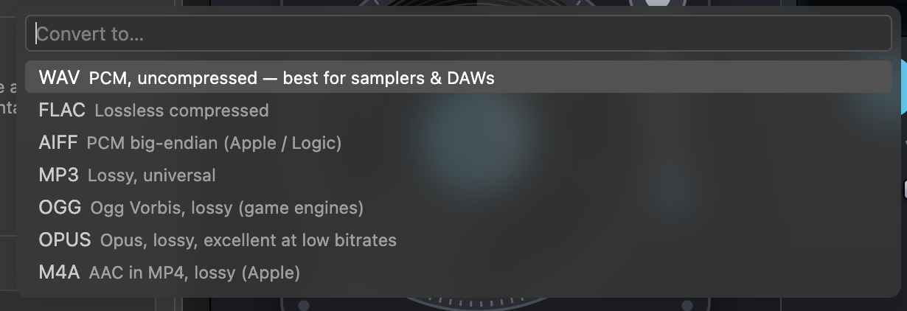

# Getting started

This page takes you from nothing to a trimmed, normalized, converted sample, and shows you where to look when something goes wrong.

## 1. Requirements

| Requirement | Details |
|---|---|
| VS Code | 1.85 or newer (`engines.vscode` is `^1.85.0`) |
| FFmpeg and ffprobe | On your `PATH`, or set `soundLab.ffmpegPath` and `soundLab.ffprobePath`. The README names 4.4 as the minimum. The extension does not check the version at start-up; it only detects which filters and encoders your build has |
| Transcription (optional) | One of: [whisper.cpp](https://github.com/ggml-org/whisper.cpp) (`whisper-cli` plus a `ggml-*.bin` model), any OpenAI-compatible `/audio/transcriptions` endpoint, or FFmpeg 8+ built with `--enable-whisper`. See [Transcription](transcription.md) |
| mlx-audio (optional) | Local text-to-speech, MLX transcription, voice cloning and separation on an Apple-silicon Mac: `brew tap cloud-fronts-group/sound-lab https://github.com/cloud-fronts-group/sound-lab`, then `brew install mlx-audio`. See [mlx-audio in the README](../README.md#mlx-audio-local-speech-ai-inside-vs-code) |
| Node.js (development only) | 20 or newer. The test suites were run on Node 22 |

Install FFmpeg with your package manager:

```bash
brew install ffmpeg        # macOS
winget install ffmpeg      # Windows
sudo apt install ffmpeg    # Debian / Ubuntu
```

## 2. Install the extension

Sound Lab's release flow builds a `.vsix` and deliberately never publishes to the Marketplace, so you install it from a file or run it from source.

**From a VSIX**

```bash
git clone git@github.com:cloud-fronts-group/sound-lab.git
cd sound-lab
npm install
npm run package                                   # → sound-lab-0.1.0.vsix
code --install-extension sound-lab-0.1.0.vsix
```

**From source (Extension Development Host)**

```bash
npm install
npm run compile
```

Open the folder in VS Code and press **F5**. The `Run Extension` launch configuration compiles first and opens a second VS Code window with Sound Lab loaded.

## 3. Check that FFmpeg is found

Look at the right side of the status bar. You should see `ffmpeg 6.1.1` (your version, without the build suffix).

| Status bar | Meaning |
|---|---|
| a pulse icon and `ffmpeg 6.1.1` | ffmpeg and ffprobe both answered `-version` |
| a warning icon and `ffmpeg missing` (yellow background) | One of them could not be run. Hover for the reason |

Click the item, or run **Sound Lab: Show FFmpeg Capabilities**, to see a report of the filters and encoders Sound Lab uses and whether your build has each one. If FFmpeg is installed but not found (common on macOS, where VS Code may not inherit your shell's `PATH`), set the absolute path:

```jsonc
{
  "soundLab.ffmpegPath": "/opt/homebrew/bin/ffmpeg",
  "soundLab.ffprobePath": "/opt/homebrew/bin/ffprobe"
}
```

Changing either setting re-checks automatically.

## 4. Your first five minutes

The steps below need no audio files; you generate one.

**Step 1: generate a tone.** Open the Command Palette and run **Sound Lab: Generate Tone / Noise…**. Choose *Sine*, then accept 440 Hz, 2 seconds and −6 dBFS. Sound Lab writes `sine_440Hz_2s.wav` into your first workspace folder (mono; a 24-bit WAV at 48 kHz unless you changed the defaults) and offers **Open** and **Reveal**.

**Step 2: open it in the editor.** Audio files open in the Sound Lab editor by default. Drag across the waveform from about 0.5 s to 1.5 s to make a selection.

**Step 3: export the selection.** Press `E` (or click **Export selection**). Sound Lab asks for fade-in and fade-out times; the default `0.005, 0.010` adds 5 ms and 10 ms anti-click fades. Press Enter. A toast confirms `Saved sine_440Hz_2s_0.00-0.01.wav`.

> The suffix is the start and end of the cut as `m.ss`, floored to whole seconds, so 0.5 s to 1.5 s becomes `0.00-0.01`. Two cuts inside the same second would collide and get a `-1`, `-2` suffix. See [file naming](commands.md#output-file-naming).

**Step 4: normalize.** In the Explorer, right-click `sine_440Hz_2s.wav`, choose **Sound Lab → Normalize Loudness…**, then *Loudness -14 LUFS*. Two ffmpeg passes run, and `sine_440Hz_2s_-14LUFS.wav` appears.

**Step 5: convert.** Right-click the file again and choose **Convert Format…**. Pick **FLAC**, then 24-bit, *Keep* sample rate and *Keep channels*. You get `sine_440Hz_2s.flac`.



*The first prompt of **Convert Format…**. Each format carries a one-line hint.*

**Step 6: browse your samples.** Click the **Sound Lab** icon in the activity bar. The Samples view lists every audio file in the workspace; expand one to see duration, codec, sample rate and channels. See [Samples view](samples-view.md).

Your originals are untouched: every step above created a new file.

## 5. Watch what FFmpeg is doing

Run **Sound Lab: Show FFmpeg Log** (it is also in the **⋯** menu of the Samples view's title bar). Each job writes its title; jobs that create or render files also write the exact command line and FFmpeg's own messages. (**Analyze Loudness & Levels** and **Show Media Info** log only their titles, and **Transcribe** logs its backend's messages but no `$ ffmpeg` line.) This is the log for step 5 (**real output**):

```text
▶ Converting 1 file(s) to FLAC
$ ffmpeg -hide_banner -nostdin -y -i /Users/me/samples/sine_440Hz_2s.wav -map 0:a:0 -map_metadata 0 -c:a flac -compression_level 8 -sample_fmt s32 -bits_per_raw_sample 24 /Users/me/samples/sine_440Hz_2s.flac
Input #0, wav, from '/Users/me/samples/sine_440Hz_2s.wav':
  Metadata:
    encoder         : Lavf60.16.100
  Duration: 00:00:02.00, bitrate: 1152 kb/s
  Stream #0:0: Audio: pcm_s24le ([1][0][0][0] / 0x0001), 48000 Hz, mono, s32 (24 bit), 1152 kb/s
Stream mapping:
  Stream #0:0 -> #0:0 (pcm_s24le (native) -> flac (native))
Output #0, flac, to '/Users/me/samples/sine_440Hz_2s.flac':
  Metadata:
    encoder         : Lavf60.16.100
  Stream #0:0: Audio: flac, 48000 Hz, mono, s32 (24 bit), 128 kb/s
    Metadata:
      encoder         : Lavc60.31.102 flac
[out#0/flac @ 0x55ad9782dc80] video:0kB audio:106kB subtitle:0kB other streams:0kB global headers:0kB muxing overhead: 7.601996%
✔ Converting 1 file(s) to FLAC
```

Copy any `$ ffmpeg …` line into a terminal to repeat the operation by hand. The per-frame `size=… time=…` progress lines are filtered out to keep the log readable.

Long jobs show a progress notification with a **Cancel** button. Cancelling stops ffmpeg immediately and the job is logged as `✖ … cancelled`. The extension does not delete the output ffmpeg had started, so a partly written file can remain next to your source; delete it if you see one. (Recording is the exception: **Cancel** is how you stop it, and the file is finalized properly.)

## 6. Where results go

By default, next to the source file, named `<source>_<suffix>.<ext>`. If the name exists, Sound Lab adds `-1`, `-2`… instead of overwriting. Two settings change this:

```jsonc
{
  // All results in one folder, created if missing
  "soundLab.output.directory": "${workspaceFolder}/export",
  // Replace existing results instead of adding a numeric suffix
  "soundLab.output.overwrite": false
}
```

See [Configuration](configuration.md#output-location) for the variables you can use.

## 7. Next steps

- Learn the editor's mouse and keyboard controls: [Audio editor](audio-editor.md).
- Chop a recording into one-shots or slice a loop to the beat: [Cookbook](cookbook.md).
- Set up speech-to-text: [Transcription](transcription.md).
- Something not working: [Troubleshooting](troubleshooting.md).
