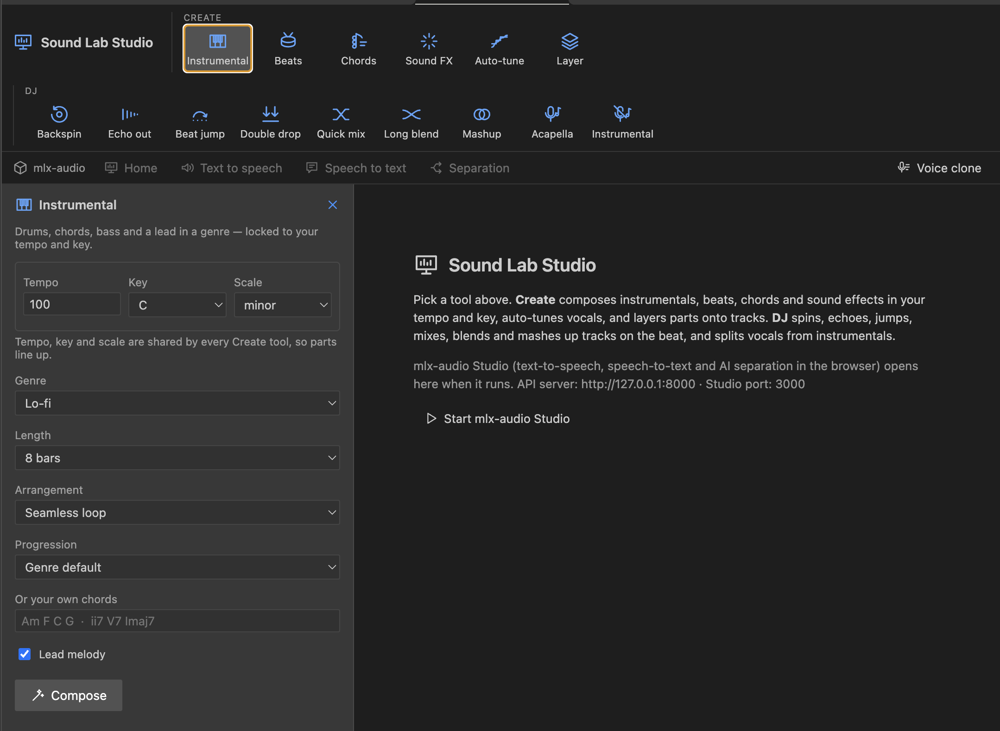
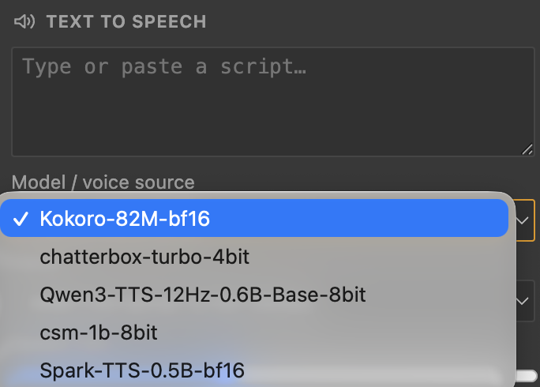
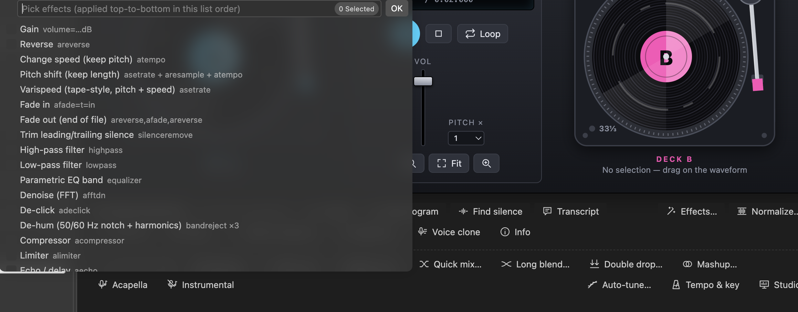

# Sound Lab Studio (from screenshots)

> **Status: not in this repository snapshot.** The screens on this page appear in screenshots taken on 2026-11-03, but `main` at commit `b8adc0b` contains no Studio, mlx-audio, text-to-speech or DJ code: a search of the repository for `studio`, `mlx`, `kokoro`, `backspin`, `acapella`, `mashup` and `voice clone` finds nothing outside `.gitignore` comments about Visual Studio, and `package.json` contributes no Studio command, view or setting. This page therefore describes **only what the screenshots show**. It does not describe how these screens behave, which files they write, or which commands and settings drive them. A project note about a Claude Code plugin with the same name is summarised [below](#what-the-sound-lab-project-notes-say).

The four screenshots in these docs are:

| Screenshot | In this repository's code? |
|---|---|
| [Convert to… picker](images/convert-format-picker.png) | Yes: `pickFormat()` in `src/commands.ts`. See [Commands](commands.md#convert-format) |
| [Pick effects picker](images/effects-picker.png) | Yes: `cmdApplyEffects()`. See [Effects](effects.md) |
| [Text to speech panel](images/studio-text-to-speech.png) | No |
| [Sound Lab Studio screen](images/sound-lab-studio.png) | No |

## The Studio screen

*Sound Lab Studio with the **Instrumental** tool selected (highlighted with an orange outline).*

**Toolbar.** The title **Sound Lab Studio** sits at the top left, followed by two groups of tool buttons:

| Group | Tools |
|---|---|
| **CREATE** | Instrumental, Beats, Chords, Sound FX, Auto-tune, Layer |
| **DJ** | Backspin, Echo out, Beat jump, Double drop, Quick mix, Long blend, Mashup, Acapella, Instrumental |

"Instrumental" appears in both groups with different icons: the Create tool has a keyboard icon, and the DJ button has a crossed-out microphone (next to **Acapella**, which has a plain microphone).

**Tab strip.** Below the toolbar: **mlx-audio** (a label with a cube icon), then **Home**, **Text to speech**, **Speech to text** and **Separation**, and **Voice clone** at the far right.

**Tool panel (left).** Selecting a tool opens its panel, with a close (×) button. The **Instrumental** panel reads *"Drums, chords, bass and a lead in a genre — locked to your tempo and key."* and shows these controls:

| Control | Value shown | Notes |
|---|---|---|
| Tempo | `100` | A number field |
| Key | `C` | A drop-down |
| Scale | `minor` | A drop-down |
| Genre | `Lo-fi` | A drop-down |
| Length | `8 bars` | A drop-down |
| Arrangement | `Seamless loop` | A drop-down |
| Progression | `Genre default` | A drop-down |
| Or your own chords | empty, placeholder `Am F C G · ii7 V7 Imaj7` | Free text |
| Lead melody | checked | A check box |
| **Compose** | | The action button |

A line under the first three controls says *"Tempo, key and scale are shared by every Create tool, so parts line up."*

**Welcome pane (right).** The text explains the two groups: **Create** composes instrumentals, beats, chords and sound effects in your tempo and key, auto-tunes vocals and layers parts onto tracks; **DJ** spins, echoes, jumps, mixes, blends and mashes up tracks on the beat, and splits vocals from instrumentals. A second paragraph says that **mlx-audio Studio** (text-to-speech, speech-to-text and AI separation in the browser) *opens here when it runs*, and gives the addresses **API server: `http://127.0.0.1:8000`** and **Studio port: `3000`**. A **Start mlx-audio Studio** button sits below it.

## The Text to speech panel

*The **Text to speech** panel with its model list open.*

The panel is headed **TEXT TO SPEECH** and contains a multi-line text area with the placeholder *"Type or paste a script…"*, then a **Model / voice source** drop-down. With the list open, these entries are visible, with the first one checked:

1. `Kokoro-82M-bf16` (selected)
2. `chatterbox-turbo-4bit`
3. `Qwen3-TTS-12Hz-0.6B-Base-8bit`
4. `csm-1b-8bit`
5. `Spark-TTS-0.5B-bf16`

The list is cut off at the bottom of the screenshot, so there may be more entries. A second drop-down and a toggle are partly visible behind it but cannot be read.

## The editor behind the effects picker

*The same screenshot used on the [Effects](effects.md) page, here for what is behind the picker.*

The quick pick is this repository's **Apply Effects / Filter Chain…** prompt. Behind it is an editor view that differs from the one in `media/editor.js`:

- A **DECK B** turntable graphic with a pink "B" label and a "33⅓" marking, and the text *"No selection — drag on the waveform"* beneath it (the same message the repository's editor shows).
- A transport area with a **Loop** button, a stop button, a vertical **VOL** fader, a **PITCH ×** selector (value `1`), and **Fit** and zoom buttons.
- Action buttons: **Find silence**, **Transcript**, **Effects…**, **Normalize…** (the right edge is cut off), **Voice clone** and **Info**, with part of a **Spectrogram** button visible at the left.
- A DJ row: **Quick mix…**, **Long blend…**, **Double drop…**, **Mashup…**.
- A further row: **Acapella**, **Instrumental**, **Auto-tune…**, **Tempo & key** and a partly visible **Studio** button.

Compare with the editor documented in [Audio editor](audio-editor.md), whose action bar has **Export selection**, **Zoom to selection**, **Levels**, **Spectrogram**, **Find silence**, **Transcript**, **Effects…**, **Normalize…**, **Convert…**, **Slice…**, **Split on silence…** and **Info**. The buttons **Find silence**, **Transcript**, **Effects…**, **Normalize…** and **Info** exist in both; the deck, fader, pitch selector and the buttons **Voice clone**, **Quick mix…**, **Long blend…**, **Double drop…**, **Mashup…**, **Acapella**, **Instrumental**, **Auto-tune…**, **Tempo & key** and **Studio** are not in this repository's source. The crop hides the right-hand end of that row, so the screenshot cannot show whether **Convert…**, **Slice…** and **Split on silence…** are still present.

## What the Sound Lab project notes say

The Sound Lab Project in Claude holds a note, `sound-lab-studio-plugin.md` (written on 2026-11-02, before these screenshots), that describes **Sound Lab Studio as a Claude Code plugin**. The plugin is installed from the same GitHub repository, `cloud-fronts-group/sound-lab`. The note describes no VS Code screens, so it does not explain the screenshots above. Its main points, as written there:

- **What it is:** skills, slash commands, agents and hooks for audio and video work, plus an MCP server named `sound-lab-media` that runs long media jobs in the background.
- **Speech through MLX:** text-to-speech (the note names Kokoro), Whisper/MLX speech-to-text and audio separation go through an *mlx-audio* service on port `8000`. It can run natively on an Apple-silicon Mac (Metal GPU), in Docker or Podman (CPU, or NVIDIA CUDA 12), in an Apple container (CPU), or against an external server.
- **What lines up with the screenshots:** port `8000`, Kokoro at the top of the model list, and the *Speech to text* and *Separation* tabs.

The note says nothing about the Create and DJ tool groups, the Instrumental panel, the deck view or the Studio port `3000`, so those stay undocumented beyond what the screenshots show. None of the note's claims were checked against code, because no plugin, MCP or Studio code exists in this checkout.

## What is missing, and how to close the gap

As of 2026-11-03, no branch, tag, stash or commit in the local clone holds Studio or plugin code; its last known `origin/main` is `b8adc0b`. If that code lives on the remote, in another folder or in another repository, add it here (or point to it) and extend this page with:

- the command IDs, menu entries and settings that open and configure Studio;
- how the mlx-audio service is started and stopped, and which ports and hosts it uses;
- what each Create and DJ tool writes, where, and under which file names;
- where text-to-speech models come from, and how the model list is built;
- tests and limits, in the style of [Architecture](architecture.md).

Until then, treat this page as a tour of the interface, not as a specification.
